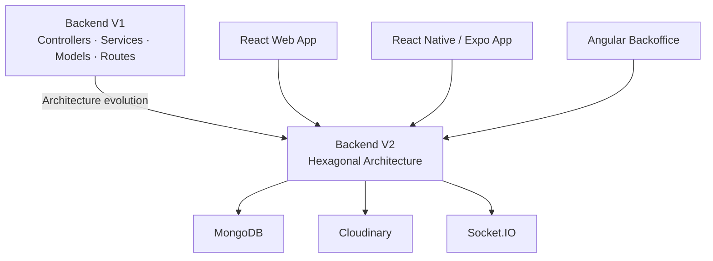

# LPlan

A multi-client full-stack platform for discovering activities, connecting with other users, and organizing social plans.

LPlan was developed in 2023 as a five-person university engineering project. The project includes a web application, a mobile application, an administration backoffice, and two generations of the backend that show the evolution from the original implementation to a hexagonal architecture.

In 2026, the original repositories were consolidated into this monorepo for portfolio and archival purposes while preserving the original Git authorship, commit dates, and development history.

## Architecture



## Repository Structure

| Component | Purpose | Main Technologies |
| --- | --- | --- |
| `backend-v1/` | Original REST API | Node.js, Express, TypeScript, MongoDB, Mongoose, JWT |
| `backend-v2-hexagonal/` | Redesigned backend using hexagonal architecture | TypeScript, Express, MongoDB, Jest, Socket.IO, Cloudinary |
| `web/` | Browser client | React, TypeScript, FullCalendar, Leaflet, Chart.js, Socket.IO |
| `mobile/` | Mobile client | React Native, Expo, TypeScript, Maps, QR, WebRTC |
| `backoffice/` | Administration interface | Angular, TypeScript, Bootstrap, RxJS |

## Backend Evolution

One of the most relevant parts of the project is that both backend generations have been preserved.

### Backend V1

The first backend follows a conventional application structure built around controllers, services, models and routes.

It implements functionality such as authentication, users, publications, activities, locations, applications, comments, feeds and social relationships.

### Backend V2 — Hexagonal Architecture

The second backend reorganizes the application around three main areas:

```text
src/
├── domain/
├── application/
└── infraestructure/
```

The objective was to separate business concepts and use cases from external concerns such as HTTP controllers, persistence and third-party services.

The second version also introduced or expanded functionality including real-time communication, Cloudinary integration, testing, email services and richer publication functionality.

Keeping both implementations in the repository makes the architectural evolution of the project visible instead of hiding the original design.

## Main Functionality

LPlan contains functionality around user accounts and profiles, followers and following, activity discovery, feeds, publications, comments and likes.

The different clients also implement features such as calendars, locations and maps, activity participation, chat, profile sharing, QR codes, statistics, localization and administration interfaces.

Some functionality differs between the web, mobile and backoffice clients because the project evolved throughout development.

## My Contributions

I worked across all five parts of the project during the original 2023 development.

| Component | Selected contributions |
| --- | --- |
| **Backend V1** | Feed implementation, discovery, follow/unfollow, pagination, activity functionality, routing fixes and Docker configuration |
| **Backend V2** | Publication services, loading additional publications, users who liked a publication, add/remove likes, publication population fixes and external URL sharing |
| **Web** | Chat, profile calendar, participant photos, user types, text-to-speech integration, loading UI and HTTPS/deployment-related changes |
| **Mobile** | QR generation and scanning, profile sharing, user types, automatic loaders, word filtering and audio-description-related functionality |
| **Backoffice** | Integration with the hexagonal backend, user-edit improvements, SweetAlert user feedback, Docker configuration and UI/development fixes |

These contributions are preserved in the Git history together with the work of the other original team members.

## Team

LPlan was a collaborative project. The original Git history has been deliberately preserved so authorship remains attributable at commit level.

Original contributors include:

- **VictorFernandezEscriva**
- **oscarboullosa**
- **eloimoncho**
- **Genisc13**
- **Marc Moran M**

The project should therefore be understood as team work rather than as an individual application.

## Tech Stack

**Backend**

Node.js · TypeScript · Express · MongoDB · Mongoose · JWT · bcrypt · Jest · Socket.IO · Cloudinary · Nodemailer

**Web**

React · TypeScript · React Router · Axios · FullCalendar · Leaflet · Chart.js · Socket.IO · i18next

**Mobile**

React Native · Expo · TypeScript · React Navigation · Maps · QR · WebRTC · localization · Socket.IO

**Backoffice**

Angular · TypeScript · Bootstrap · RxJS · SweetAlert2

**Tooling**

Git · Docker · npm · ESLint · Prettier

## Running the Project

The repository contains several independent applications. Dependencies should be installed inside the component that you want to run.

### Backend V1

```bash
cd backend-v1
npm install
npm run dev
```

Create a local `.env` from `.env.example` and provide the required configuration values.

### Backend V2

```bash
cd backend-v2-hexagonal
npm install
npm run dev
```

To build:

```bash
npm run build
```

To run the available Jest tests:

```bash
npm test
```

A local `.env` must be created from `.env.example`.

### Web

```bash
cd web
npm install
npm start
```

The application uses environment-specific configuration. Start from `.env.example`.

### Mobile

```bash
cd mobile
npm install
npm start
```

Android development can also be started with:

```bash
npm run android
```

Some integrations require local configuration that is intentionally not included in the repository, including environment variables and Google/Firebase service configuration.

### Backoffice

```bash
cd backoffice
npm install
npm start
```

## Repository History

The application was originally developed across several independent Git repositories during 2023.

For this portfolio version, those repositories were consolidated into a single monorepo in 2026. The histories were rewritten only where necessary to:

1. remove credentials and generated development files,
2. place each original repository under its corresponding monorepo directory, and
3. combine the independent histories into a single `main` branch.

Original authors, commit messages and commit dates were retained.

The resulting repository therefore contains both the original development history and the later portfolio-oriented cleanup commits.

## Project Status

This repository represents an archived university project reorganized for technical documentation and portfolio purposes.

The code reflects the technologies, design decisions and development practices used during the original 2023 project rather than a newly rewritten production application.

## License

No repository-wide open-source license has currently been assigned to this consolidated version.